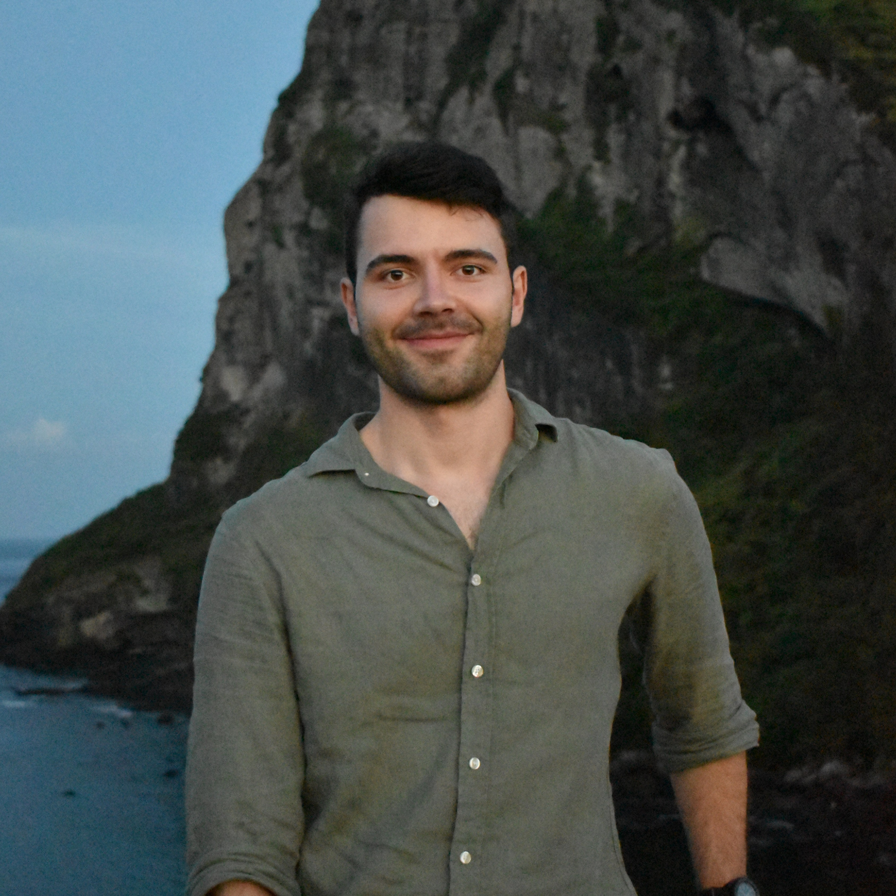

    

I'm currently a PhD student at the [Chair of Automatic Control Engineering](https://www.ce.cit.tum.de/en/lsr/home/) at the [Technical University of Munich (TUM)](https://www.tum.de/en/).

My research focuses on safe and optimal control of uncertain dynamical systems, where the dynamics or the current state of the system under control are not exactly known. Examples include a drone carrying an unknown payload, an aircraft whose dynamics change with flight conditions, or a patient whose response to a drug is not yet known. Controlling such systems involves a trade-off between exploration and exploitation, as actions should perform well under current knowledge while also providing useful information about what is uncertain in the system. Dual control tackles this trade-off by combining *caution*, i.e., acting carefully while being uncertain, with *probing*, i.e., deliberately reducing that uncertainty. However, optimal dual control is generally intractable. I therefore develop methods that keep its performance without the computational burden, and additionally study how active learning affects closed-loop stability and safety. To this end, I combine learning-based and adaptive control with probabilistic modeling, approximate dynamic programming, Bayesian reinforcement learning, and model predictive control.

I've obtained my master's degree in [Robotics, Cognition, Intelligence](https://www.tum.de/en/studies/degree-programs/detail/robotics-cognition-intelligence-master-of-science-msc) from [TUM](https://www.tum.de/en/). During my masters, I had the opportunity to be an exchange student at the [Johou Systems Kougaku (JSK) Laboratory](http://www.jsk.t.u-tokyo.ac.jp/index.html) at the [University of Tokyo](https://www.u-tokyo.ac.jp/en/) under the supervision of [Prof. Kei Okada](https://scholar.google.co.jp/citations?user=456Oe4YAAAAJ&hl=en).

Prior to that, I've been a corporate student at [Robert Bosch GmbH](https://www.bosch.de/en/), where I worked in different departments in Abstatt, Curitiba (Brazil), and Renningen.

---

**Social Media:** [GitHub](https://github.com/chrisnarr), [LinkedIn](https://www.linkedin.com/in/christopher-narr/), [Google Scholar](https://scholar.google.com/citations?user=aOMgEOUAAAAJ)
